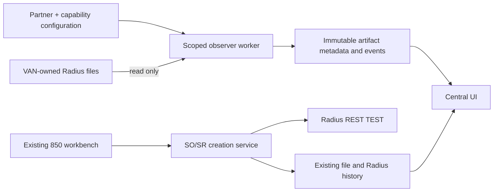

# Radius EDI Central architecture

The app remains a modular Python service. The existing REST inbound 850 adapter runs unchanged through `service.py` and `radius.py`. `central.py` owns versioned partner/capability configuration and read-only file observation. `central_ui.py` adds the operator workspace to the authenticated Flask app. `--central-worker` is a separate polling process sharing the SQLite state file.

`mapping_engine.py` supplies bounded declarative field rules and format previews; `mappings.py` versions definitions and records sample validation evidence. `mapping_ui.py` provides the editor and TEST handoff, and `mapping_api.py` prepares mapped customer orders for the existing creation service. Direct customers use this API bridge without an intermediate 850 file, as explicitly clarified by the user. A source file's published revision/scope is pinned in `central_mapping_file_links` for later submissions and retries. Manual TEST submission is available; automatic direct intake/delivery workers remain a separate increment. See [MAPPING_AND_ONBOARDING.md](MAPPING_AND_ONBOARDING.md).

Each capability has typed environment, direction, EDI message, route class, processing strategy, mode, path roles, and independent enabled state. The four strategy combinations are derived from route and direction, never entered as an arbitrary free-text label. Only `PASSTHROUGH_TRACK` can currently be enabled with verified Radius activation, a verified folder contract, an enabled partner, and an allowed observation root. LIVE observation requires an additional explicit authorization flag; the user authorized Niagara LIVE outbound 856 monitoring. A capability marked `PLANNED` is configuration only. `outbound856.py` provides format 1 reference extraction with independent parsing status; it does not transform or deliver files. The web launcher uses `--observe` to run the same worker in a background thread while the server runs. No UI state calls an outbound translator operational.

The platform schema coexists with existing `orders`, `files`, `file_events`, and `radius_records`. Existing 850 customer JSON profiles are listed from the central home page and continue to be edited through their current forms. Migration to the new capability handler requires tested parity before replacing the legacy intake. One SQLite file works for the local deployment; enterprise multi-node scaling needs a supported transactional database and coordinated worker lease validation. **TO VERIFY:** target enterprise hosting, identity, database, backup, and secret vault standards.
