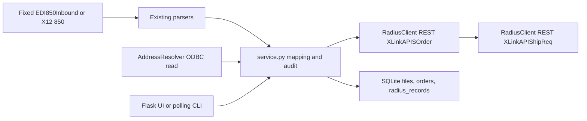

# Existing application assessment (2026-10-14)

## Inventory opened

The application is Python 3.10+, Flask, Waitress, SQLite, `requests`, and `pyodbc` (`requirements.txt`). `niagara_edi/__main__.py` runs a one-file CLI, a polling inbox, or the web server. `dashboard.py` serves the local operator UI. `service.py` owns validation, mapping, idempotency, Radius POST ordering, and file audit. `edi.py` parses the supported X12 004010 850 subset; `fixed850.py` parses the supplied `EDI850Inbound` fixed-width layout. `radius.py` builds the Sales Order and Shipping Request API payloads, calls the Radius REST adapter, decodes responses, and resolves addresses with ODBC. `audit.py` holds SQLite file events and response records. `customer_config.py` stores current customer profiles in JSON. Templates and CSS are in `niagara_edi/templates` and `niagara_edi/static`. Five test modules exercise those paths. `PEP0185080209743383.txt` and `EDI850StandardFormat.xls` are local reference files; the former contains real-looking customer data and must not be copied into public fixtures.

Runtime state is under `state/`; `config.json`, state, inbox and archives are ignored by Git. The current web launch batch embeds credentials; that must be removed for managed deployment. There is no migration framework, enterprise identity provider, queue, scheduler, outbound serializer, SFTP client, or verified Radius flat-file publisher in this repository. No supplied SPS Commerce connector or AS2 gateway implementation was found; AS2 is represented by a verified receipt sidecar. The current code does not call `pxlupdate.r` or write Radius business tables directly.

## Architecture and reuse

Keep `build_sales_order`, `build_shipping_request`, `RadiusClient.post`, `AddressResolver`, and the confirmed new-order SO then SR sequence as the first inbound 850 adapter. New central customer/capability configuration, route observation, worker leases, transaction lineage, and audit should be separate modules and versioned SQLite migrations. An unverified outbound or flat-file mapping stays unavailable for activation.

## Risks and TO VERIFY

- **TO VERIFY:** Radius 2026.3 customer EDI activation, format, filename/sequence, and XLink update settings for every customer/capability. The user-supplied tutorial and screenshot are reference evidence, not a live configuration API contract.
- **TO VERIFY:** Whether the existing REST adapter is an approved long-term order-creation route for all partners; it is proven here only for the current TEST 850 flow.
- **TO VERIFY:** Owner and permissions of each Radius/VAN/customer folder, cleanup timing, and service-account access.
- **TO VERIFY:** An approved Radius outbound 856/855/810 format, sample, customer mapping, and delivery contract. These cannot be marked operational yet.
- Current polling moves files and is appropriate only for the app-owned legacy inbox. It must never be reused as a watcher on Radius/VAN-owned folders.
- Current HTTP Basic authentication is single-user and unsuitable as enterprise RBAC/SSO. Debug logs contain full prices and addresses; operator access and retention need policy.
- A failed Radius update may reflect existing Radius line master data even when the POST omits a field. Sales Order/Shipping Request updates are held pending Radius investigation.

## Baseline verification

`python -m unittest discover -s tests -q` passed 36 tests before the platform migration work. No LIVE endpoint was called.
