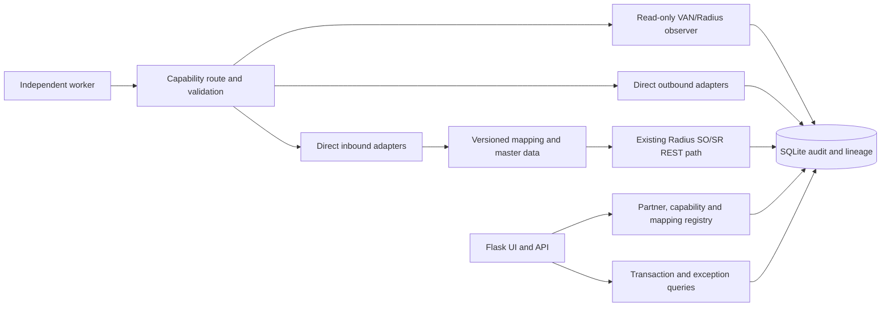

# Enterprise EDI architecture

Extend the existing Flask/SQLite process in modules; keep workers independent of browser sessions. The current REST SO/SR service remains the approved code path for supported TEST inbound 850 creation. The central worker observes verified Radius/VAN folders without mutating them.

The direct inbound API path is currently manual and TEST-only. A Radius flat-file publisher and XLink runner are separate, unverified future adapters; they must not be inferred from the existing REST client. For VAN routes, translation is off by default. For direct outbound, preserve the Radius original and record publication, transfer, receipt, acknowledgment, and business acceptance as separate evidence.

Adapter contracts should take an explicit environment, customer, capability, format version, source digest and correlation ID; return typed stage results and evidence rather than a single success flag. Workers need durable claims and recovery before automatic posting. Radius-side settings are authoritative; mismatches block activation. Existing `central_capabilities` provides the starting configuration boundary. See `EDI_PROCESSING_LIFECYCLE.md` and `EDI_DATABASE_DESIGN.md`.
