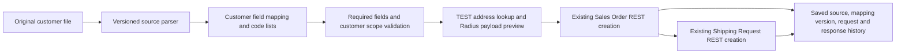

# Customer mapping and onboarding

## Direct customers use the Radius API

The user clarified the intended direct-customer flow on 2026-10-14:

No Radius 850 flat file is generated in this route. A native Radius TXT preview is an optional, separate file-import contract; it is not a required intermediate step. The new API bridge uses `process_file` and the existing payload builders, creation sequence, response interpretation, pending-state handling, saved Radius cross references, and replay protections. It adds a `mapped_customer` order source, feeding customer item references into the same Radius item-resolution path as the established fixed-850 workflow. `SOrderDate` is omitted and `SOSourceCode` remains EDI. SO/SR update submission remains on hold.

## Available workspace

Open **Mapping & master data** at `/central/mappings`.

1. Register a customer in EDI Central with its Radius customer, company and plant. Creating a mapping does not enable that customer.
2. Create an inbound 850 or outbound 856 mapping. Choose the environment and supported source/target format. Inbound defaults to the direct Radius API. Choose combined or per-line Shipping Requests.
3. Edit the reusable field template: source column or JSON dot path, target field, operation, explicit constant/default, required flag, date formats and code lookup dictionary. Customer/company/plant template constants come from the selected customer; templates do not copy another customer's address/item cross references.
4. Save and upload a representative sample. Inspect mapped values, field-level issues, and generated output. Failed saves keep entered rules on screen for correction. Previews use saved rules and do not call Radius.
5. Publish a tested mapping definition. A successful preview must match the current rule hash and customer/environment scope. Published versions cannot be edited; clone a new draft version to change them, then test again.
6. For a published TEST direct API mapping, upload the original customer file using **Resolve addresses and preview Radius payload**. This saves the original source in the application's preview area, pins its exact mapping revision and scope, resolves addresses using the existing TEST lookup, and displays the actual SO payload. It does not send a POST.
7. Choose **Submit reviewed order to Radius TEST** to run the existing SO-then-SR creation service. File history retains the mapping event and source digest; the confirmed POST records retain request/response bodies and SO/SR numbers. Saved retries keep the pinned version, including after archival moves. Uncertain outcomes still require reconciliation.

For outbound, the current mapper produces a validated CSV/JSON sample or downloadable output in the authenticated browser. It does not automatically deliver to SFTP/AS2, publish into another party's folder, or claim customer acceptance. A VAN pass-through observer does not apply these transformations automatically.

## Supported preview contracts

| Flow | Inputs | Target | Scope |
| --- | --- | --- | --- |
| Direct inbound 850 | UTF-8 CSV with unique header columns; JSON row object/array or `{ "rows": [...] }`; existing X12 004010 850 subset; existing fixed-width 850 TXT | Direct Radius SO/SR API preparation | Flat line rows grouped by PO, with consistent header values; required mapped fields and exact customer/company/plant scope |
| Optional native inbound 850 | Same inputs | Common-field Radius 850 TXT preview | Header/line/SR records, fixed positions, widths and control totals; round-trip parser validation; native Radius ingestion remains a separate unverified operational handoff |
| Direct outbound 856 | Radius Standard Outbound 856 format 1 TXT or normalized JSON rows | Customer CSV or JSON | Source customer/company/plant must match the profile; includes verified BOL/SR/SO/PO references, ship date, item and shipped quantity when present |

The 856 preview flattens shipping-note lines. It does not yet preserve pick/pallet/packing hierarchies and is not a complete X12 856 or cXML ASN serializer. Required customer output fields must be configured from that customer's guide. The X12 input adapter implements the existing tested 004010 subset; a different version or partner convention needs its own validated adapter.

CSV has a comma delimiter and a header row. JSON can use dot paths within each row (for example `header.po_number`); arbitrary repeating nested structures and generic XML paths are not supported in this first contract. Customer-specific parsers normalize those structures into line rows before mapping. X12 input exposes source qualifiers as `ItemRef_VN`, `ItemRef_BP`, `ItemRef_CI`, etc.; a vendor part number is not silently treated as the Radius customer item reference. Its explicit lookup must be configured where needed. Standards and format versions are separate from SFTP/AS2/HTTPS transport settings. The current direct handoff is an authenticated manual upload, not a claim that AS2 authentication or a network sender identity has been verified; an automatic transport adapter must establish that separately.

## Mapping operations and rules

- `copy`, `trim`, `uppercase`, `lowercase`: map text without executable expressions.
- `constant`: explicitly provide an approved destination customer, company/plant, currency, or another fixed value.
- `default`: apply an explicit source fallback only when the source is null or empty, before its selected transformation. Whitespace-only required output still fails.
- `lookup`: exact source-to-target codes for items, addresses, units, terms and similar master data. An unknown source code fails validation; it does not create Radius master data.
- `date`: explicit input/output patterns, for example `%m/%d/%Y` to `%Y-%m-%d`.
- `number`, `multiply`: finite decimal conversion or an explicit decimal factor, with bounded precision and no executable formulas. For example, per-unit to per-thousand pricing requires an approved numeric factor and the correct price-unit code; changing only a unit label is not a price conversion.

Mapped API inputs require PO/date/currency, billing and shipping references, line item reference, PO line, quantities, units, price and required/ship dates. Unknown addresses can be repaired by an approved mapping to existing Radius AddressRef values; the application does not silently choose an address. The existing processing service adjusts actual past required/ship dates according to its current policy; a blank date is not automatically replaced by today. Explicit defaults must be approved by the operator/business owner.

Limits: 10 MB source upload, 1,000 line rows, 200 rules, 1,000 lookup entries per rule, 5,000 characters per mapped scalar and 5 MB of mapped values. Preview history stores hashes, counts and actor; it does not store source or transformed sample content. API preparation separately retains the original file through the established file-audit workflow.

## Versioning and isolation

Migration `004_mappings.sql` adds `central_mapping_profiles`, `central_mapping_revisions`, `central_mapping_runs`, and `central_mapping_file_links`. Scope includes environment, partner, Radius customer/company/plant, source and target format, message direction/type and Shipping Request mode. Editing a customer scope invalidates old proof for API handoff. Published revisions are immutable; saved source files cannot silently change mapping or scope. Draft updates use an edit counter to reject stale saves.

API preparation and submission require a published TEST inbound API mapping and an enabled partner. LIVE definitions may be previewed, but LIVE API submission through this bridge is blocked. No generic mapping execution code reads arbitrary file paths, evaluates expressions, changes Radius SQL tables or executes XLink commands.

Mapped order business keys include environment, customer scope and PO, and do not include mapping version; changing a definition is not permission to create another order. A changed/uncertain PO follows the existing reconciliation rules. Known SO records for the same environment/customer/company/plant/PO from another route are held for reconciliation before a mapped POST. The existing legacy adapters have their older business-key scheme; this historical check is not a universal atomic claim across concurrently running old/new adapters, so do not run both routes on the same order during migration without reconciliation and cutover control.

## Ariba / SAP Business Network and other customers

SAP Business Network supports cXML integration and can route EDI purchase orders as ASC X12 or UN/EDIFACT to supplier systems. cXML includes order requests, confirmations, shipping notices and invoices. Sources: [SAP EDI connection guide](https://help.sap.com/docs/business-network-for-procurement/introduction-to-sap-business-network-207b8f3d3d054df1a3c1333dcfdd2550/connecting-to-sap-business-network-through-edi), [official cXML resources](https://www.cxml.org/index.html).

Recommended extensible design: partner transport → versioned parser → normalized PO/shipment/invoice model → reusable customer mapping → Radius API or customer serializer → audited delivery/acknowledgment. This is an architectural recommendation based on the documented formats, not a claim that every customer uses one standard. cXML, X12, EDIFACT, CSV and JSON remain separate adapters. Buying through Ariba does not by itself identify the agreed integration method or mandatory buyer-specific fields.

For an Ariba buyer, obtain the buyer's implementation guide and agreed cXML/X12/EDIFACT versions, PO/ASN/invoice samples, sender/receiver identities (including applicable network IDs), test endpoint and credential references, address/item/unit cross references, required extrinsic fields, acknowledgments and change/cancellation policies. Build `OrderRequest` ingestion and any `ConfirmationRequest`, `ShipNoticeRequest` or `InvoiceDetailRequest` serialization as separate contract-tested adapters. These adapters and network connectivity are planned, not selectable as installed capabilities today.

## Next increments

1. Finish and verify Niagara's missing address/item/unit/date data through a draft mapping, then review a TEST API payload and an explicitly submitted UAT order.
2. Add a scoped direct-customer intake worker using the approved SFTP landing folder, pinned published mapping, stable-file handling and environment gates. Preserve provider/Radius ownership and never run two consumers on the same order.
3. Implement the first buyer-specific Ariba/cXML or full X12 outbound contract when its guide/samples are supplied.
4. Add delivery/receipt adapters, richer code-list administration and lookup-table reuse, automated master-data prerequisite checks, role approvals and complete production release gates.
